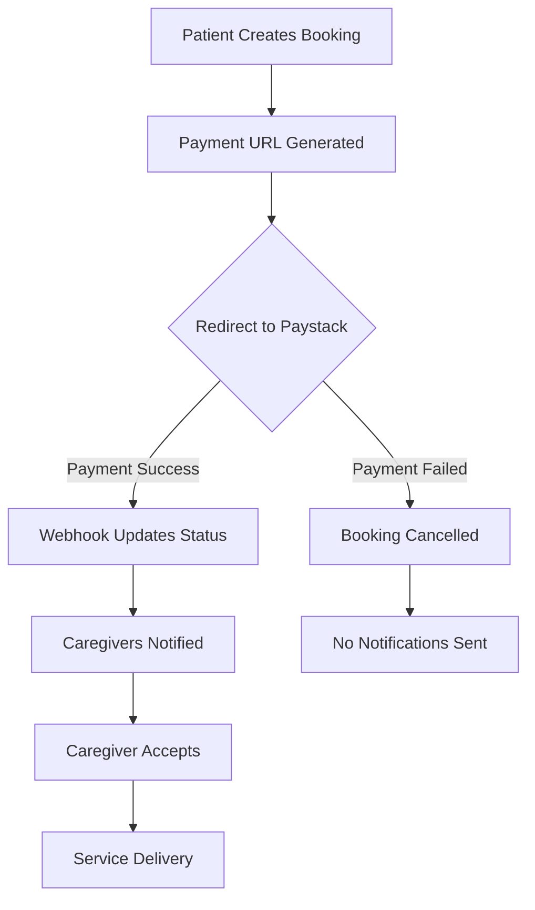

# Booking API Integration Guide for Frontend

## Overview
This guide provides comprehensive documentation for integrating the Oaklycare booking system with payment processing via Paystack. The booking flow ensures payment is completed before caregivers are notified.

## Table of Contents
1. [Authentication](#authentication)
2. [Booking Flow Overview](#booking-flow-overview)
3. [API Endpoints](#api-endpoints)
4. [Payment Integration](#payment-integration)
5. [Error Handling](#error-handling)
6. [Testing](#testing)

---

## Authentication

All booking endpoints require authentication via Bearer token in the Authorization header:

```javascript
headers: {
  'Authorization': 'Bearer YOUR_AUTH_TOKEN',
  'Content-Type': 'application/json'
}
```

---

## Booking Flow Overview



### Key Points:
- **Payment Required**: Bookings require successful payment before caregivers are notified
- **Automatic Cancellation**: Failed payments automatically cancel the booking
- **Real-time Updates**: Webhook handles payment status updates

---

## API Endpoints

### 1. Get Booking Preview (Pricing)
**Endpoint:** `POST /api/v1/booking/preview`

**Description:** Get detailed pricing breakdown and availability estimate before creating a booking

**Authentication:** Not required (public endpoint)

**Request Body:**
```json
{
  "service_type": "nurse",  // Options: nurse, doctor, physiotherapist, caregiver, nutritionist
  "duration_hours": 4,  // 1-24 hours
  "patient_latitude": 6.5244,  // Optional - for caregiver availability estimate
  "patient_longitude": 3.3792   // Optional - for caregiver availability estimate
}
```

**Success Response (200):**
```json
{
  "service_type": "nurse",
  "duration_hours": 4,
  "base_fee_per_hour": 5000.0,
  "service_multiplier": 1.0,
  "service_fee": 20000.0,
  "platform_fee": 2000.0,
  "platform_fee_percent": 10.0,
  "total_amount": 22000.0,
  "currency": "NGN",
  
  "surge_pricing_active": false,
  "surge_multiplier": null,
  "discount_active": true,
  "discount_percent": 15.0,
  
  "pricing_breakdown": {
    "base_calculation": 20000.0,
    "surge_adjustment": 0.0,
    "discount_savings": 3000.0,
    "service_fee_final": 17000.0,
    "platform_fee": 1700.0,
    "total": 18700.0
  },
  
  "estimated_caregivers_available": 8,  // Only if location provided
  "peak_hours_warning": null  // Warning message if applicable
}
```

### 2. Create Booking
**Endpoint:** `POST /api/v1/booking/create`

**Description:** Creates a new booking and initiates payment process

**Request Body:**
```json
{
  "service_type": "nurse",  // Options: nurse, doctor, physiotherapist, caregiver, nutritionist
  "assistance_type": "Personal care and medication assistance",
  "condition": "Diabetes management",  // Optional
  "duration_hours": 4,  // 1-24 hours
  "scheduled_date": "2024-01-15T14:00:00Z",
  "patient_address": "123 Main Street, Lagos, Nigeria",
  "patient_latitude": 6.5244,
  "patient_longitude": 3.3792,
  "patient_city": "Lagos",
  "patient_state": "Lagos State",
  "special_instructions": "Patient prefers female caregiver",  // Optional
  "booking_for": "Myself"  // Who the booking is for
}
```

**Success Response (200):**
```json
{
  "id": "550e8400-e29b-41d4-a716-446655440000",
  "booking_code": "BKG12345",
  "status": "pending",
  "payment_status": "pending",
  "total_amount": 15000.00,
  "service_fee": 13500.00,
  "platform_fee": 1500.00,
  "payment_url": "https://checkout.paystack.com/abcd1234",  // Redirect user here
  "payment_access_code": "abc123xyz",
  "patient_details": {
    "patient_id": "uuid",
    "full_name": "Jane Doe",
    "phone_number": "+234123456789"
  },
  "scheduled_date": "2024-01-15T14:00:00Z",
  "created_at": "2024-01-10T10:00:00Z"
}
```

**Error Response (Payment Initialization Failed):**
```json
{
  "id": "550e8400-e29b-41d4-a716-446655440000",
  "booking_code": "BKG12345",
  "status": "cancelled",
  "payment_status": "failed",
  "payment_error": "Payment gateway temporarily unavailable",
  "payment_url": null
}
```

### 2. Verify Payment Status
**Endpoint:** `POST /api/v1/booking/{booking_id}/verify-payment`

**Description:** Verify payment status after user returns from Paystack

**Success Response (200):**
```json
{
  "status": "success",
  "message": "Payment verified successfully",
  "booking_id": "550e8400-e29b-41d4-a716-446655440000",
  "payment_status": "paid",
  "amount_paid": 15000.00,
  "paid_at": "2024-01-10T10:05:00Z"
}
```

**Pending Response (200):**
```json
{
  "status": "pending",
  "message": "Payment not yet completed",
  "booking_id": "550e8400-e29b-41d4-a716-446655440000",
  "payment_status": "pending"
}
```

### 3. Get Patient's Bookings
**Endpoint:** `GET /api/v1/booking/patient/bookings?status=pending`

**Query Parameters:**
- `status` (optional): Filter by status (pending, accepted, in_progress, completed, cancelled)

**Response (200):**
```json
[
  {
    "id": "550e8400-e29b-41d4-a716-446655440000",
    "booking_code": "BKG12345",
    "status": "accepted",
    "payment_status": "paid",
    "caregiver_details": {
      "caregiver_id": "uuid",
      "full_name": "Dr. John Smith",
      "specialization": "Registered Nurse",
      "profile_image_url": "https://cdn.example.com/profiles/caregiver123.jpg",
      "current_latitude": 6.5300,
      "current_longitude": 3.3800,
      "distance_from_patient": 2.5,
      "estimated_arrival_time": 15,
      "is_online": true
    },
    "scheduled_date": "2024-01-15T14:00:00Z",
    "total_amount": 15000.00
  }
]
```

### 4. Get Booking Details
**Endpoint:** `GET /api/v1/booking/booking/{booking_id}`

**Description:** Get detailed information about a specific booking

### 5. Live Tracking (During Service)
**Endpoint:** `GET /api/v1/booking/booking/{booking_id}/live-tracking`

**Description:** Get real-time caregiver location during active service

**Response (200):**
```json
{
  "booking_id": "550e8400-e29b-41d4-a716-446655440000",
  "caregiver_id": "uuid",
  "caregiver_name": "Dr. John Smith",
  "current_latitude": 6.5300,
  "current_longitude": 3.3800,
  "distance_km": 2.5,
  "estimated_arrival_minutes": 15,
  "last_updated": "2024-01-15T13:45:00Z",
  "is_moving": true,
  "booking_status": "in_progress"
}
```

---

## Payment Integration

### Frontend Implementation Steps

#### 1. Get Pricing Preview (Before Booking)
```javascript
async function getPricingPreview(serviceType, durationHours, location = null) {
  try {
    const requestBody = {
      service_type: serviceType,
      duration_hours: durationHours
    };
    
    // Include location if available for caregiver availability
    if (location) {
      requestBody.patient_latitude = location.latitude;
      requestBody.patient_longitude = location.longitude;
    }
    
    const response = await fetch('/api/v1/booking/preview', {
      method: 'POST',
      headers: {
        'Content-Type': 'application/json'
        // No auth required for preview
      },
      body: JSON.stringify(requestBody)
    });
    
    const pricing = await response.json();
    
    // Display pricing breakdown to user
    displayPricingBreakdown({
      serviceFee: pricing.service_fee,
      platformFee: pricing.platform_fee,
      totalAmount: pricing.total_amount,
      discountSavings: pricing.pricing_breakdown.discount_savings,
      availableCaregivers: pricing.estimated_caregivers_available,
      warning: pricing.peak_hours_warning
    });
    
    return pricing;
  } catch (error) {
    console.error('Failed to get pricing preview:', error);
    showError('Unable to calculate pricing. Please try again.');
  }
}

// Call this when user changes service type or duration
function onBookingDetailsChange() {
  const serviceType = document.getElementById('service-type').value;
  const duration = parseInt(document.getElementById('duration').value);
  
  if (serviceType && duration) {
    getPricingPreview(serviceType, duration, userLocation);
  }
}
```

#### 2. Create Booking and Get Payment URL
```javascript
async function createBooking(bookingData) {
  try {
    const response = await fetch('/api/v1/booking/create', {
      method: 'POST',
      headers: {
        'Authorization': `Bearer ${authToken}`,
        'Content-Type': 'application/json'
      },
      body: JSON.stringify(bookingData)
    });
    
    const result = await response.json();
    
    if (result.payment_url) {
      // Redirect to Paystack payment page
      window.location.href = result.payment_url;
    } else if (result.payment_error) {
      // Handle payment initialization error
      showError(result.payment_error);
    }
  } catch (error) {
    console.error('Booking creation failed:', error);
  }
}
```

#### 2. Handle Payment Callback
After payment, Paystack will redirect back to your specified URL. Handle this in your frontend:

```javascript
// On payment callback page
async function handlePaymentCallback() {
  const urlParams = new URLSearchParams(window.location.search);
  const bookingId = urlParams.get('booking_id');
  const reference = urlParams.get('reference');
  
  if (bookingId) {
    // Verify payment status
    const response = await fetch(`/api/v1/booking/${bookingId}/verify-payment`, {
      method: 'POST',
      headers: {
        'Authorization': `Bearer ${authToken}`
      }
    });
    
    const result = await response.json();
    
    if (result.status === 'success') {
      // Payment successful - show success message
      showSuccess('Payment successful! Caregivers have been notified.');
      navigateToBookingDetails(bookingId);
    } else if (result.status === 'pending') {
      // Payment still processing
      showInfo('Payment is being processed. Please wait...');
      // Retry verification after delay
      setTimeout(() => handlePaymentCallback(), 3000);
    } else {
      // Payment failed
      showError('Payment failed. Please try again.');
    }
  }
}
```

#### 3. Webhook Configuration (Backend Handles Automatically)
The backend webhook endpoint `/api/v1/payment/paystack/webhook` automatically:
- Verifies payment success/failure
- Updates booking status
- Notifies caregivers (only on success)
- Stores failure reasons (on failure)

---

## Error Handling

### Common Error Scenarios

| Scenario | Status Code | Action |
|----------|-------------|---------|
| Patient profile not found | 404 | Ensure user profile is complete |
| Payment initialization failed | 200 (with error) | Retry or use alternative payment |
| Booking not found | 404 | Verify booking ID |
| Access denied | 403 | Check authentication |
| Server error | 500 | Retry request |

### Error Response Format
```json
{
  "detail": "Error message description"
}
```

---

## Testing

### Test Card Details (Paystack Test Mode)
```
Card Number: 4084084084084081
CVV: 408
Expiry: Any future date
PIN: 0000
```

### Testing Flow
1. **Create Test Booking**
   - Use test environment URL
   - Create booking with minimum duration (1 hour)

2. **Complete Test Payment**
   - Use test card details above
   - Verify webhook updates booking status

3. **Verify Caregiver Notification**
   - Check that caregivers receive notifications only after payment

### Environment Variables Required
```env
PAYSTACK_PUBLIC_KEY=your_public_key
PAYSTACK_SECRET_KEY=your_secret_key
FRONTEND_URL=https://your-frontend-url.com
```

---

## Important Notes

1. **Payment Timeout**: Paystack payment links expire after 30 minutes
2. **Currency**: All amounts are in Nigerian Naira (NGN)
3. **Minimum Amount**: ₦100
4. **Maximum Amount**: ₦1,000,000
5. **Webhook Security**: All webhooks are verified using HMAC signature

---

## Support

For integration support or issues:
- Email: support@oaklycare.com
- Documentation: https://docs.oaklycare.com
- Paystack Documentation: https://paystack.com/docs

---

## Appendix: Booking Status Flow

| Status | Description | Next Actions |
|--------|-------------|--------------|
| `pending` | Paid, awaiting caregiver | Caregiver accepts/declines |
| `accepted` | Caregiver assigned | Start service |
| `in_progress` | Service ongoing | Complete service |
| `completed` | Service finished | Rate & review |
| `cancelled` | Booking cancelled | Create new booking |
| `declined` | All caregivers declined | Refund process |

---

## Version History
- **v1.0.0** (2025-09-12): Initial payment integration with Paystack
- Payment-first booking flow implemented
- Automatic caregiver notification after payment success