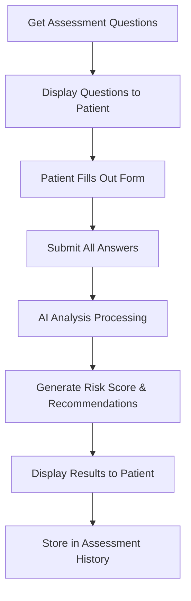

# FallGuard API Integration Guide for Frontend

## Overview
The FallGuard system is an AI-powered fall risk assessment tool that helps patients evaluate their fall risk and receive personalized prevention recommendations. This guide provides comprehensive documentation for integrating the FallGuard API with frontend applications.

## Table of Contents
1. [Authentication](#authentication)
2. [Assessment Flow Overview](#assessment-flow-overview)
3. [Patient API Endpoints](#patient-api-endpoints)
4. [Admin API Endpoints](#admin-api-endpoints)
5. [Data Models](#data-models)
6. [Frontend Implementation](#frontend-implementation)
7. [Error Handling](#error-handling)
8. [Testing](#testing)

---

## Authentication

All FallGuard endpoints require authentication via Bearer token in the Authorization header:

```javascript
headers: {
  'Authorization': 'Bearer YOUR_AUTH_TOKEN',
  'Content-Type': 'application/json'
}
```

### Authentication Types:
- **Patient endpoints**: Require patient authentication token
- **Admin endpoints**: Require admin authentication token

---

## Assessment Flow Overview



### Key Concepts:
- **Complete Assessment**: All questions answered in one session
- **AI-Powered Analysis**: Generates personalized recommendations
- **Historical Tracking**: Patients can view previous assessments
- **Risk Scoring**: Numerical score indicating fall risk level

---

## Patient API Endpoints

### 1. Get Assessment Questions
**Endpoint:** `GET /api/v1/fallguard/questions`

**Description:** Retrieve all active assessment questions for the patient to complete

**Authentication:** Patient token required

**Response (200):**
```json
[
  {
    "id": "550e8400-e29b-41d4-a716-446655440001",
    "question_text": "How often do you feel unsteady when walking?",
    "question_type": "multiple_choice",
    "options": [
      {"value": "never", "label": "Never", "score": 0},
      {"value": "rarely", "label": "Rarely", "score": 1},
      {"value": "sometimes", "label": "Sometimes", "score": 2},
      {"value": "often", "label": "Often", "score": 3},
      {"value": "always", "label": "Always", "score": 4}
    ],
    "is_required": true,
    "order_index": 1
  },
  {
    "id": "550e8400-e29b-41d4-a716-446655440002", 
    "question_text": "Have you fallen in the past 12 months?",
    "question_type": "yes_no",
    "options": [
      {"value": "yes", "label": "Yes", "score": 3},
      {"value": "no", "label": "No", "score": 0}
    ],
    "is_required": true,
    "order_index": 2
  }
]
```

### 2. Submit Assessment
**Endpoint:** `POST /api/v1/fallguard/submit`

**Description:** Submit completed assessment answers for AI analysis

**Authentication:** Patient token required

**Request Body:**
```json
{
  "answers": [
    {
      "question_id": "550e8400-e29b-41d4-a716-446655440001",
      "answer": "sometimes"
    },
    {
      "question_id": "550e8400-e29b-41d4-a716-446655440002",
      "answer": "yes"
    }
  ]
}
```

**Success Response (200):**
```json
{
  "id": "assessment-uuid-here",
  "patient_id": "patient-uuid-here",
  "total_score": 6,
  "ai_summary": "Based on your responses, you show a moderate risk for falls. You have experienced falls recently and sometimes feel unsteady while walking, which are important risk factors to address.",
  "ai_recommendations": [
    "Consider installing grab bars in your bathroom, especially near the toilet and in the shower",
    "Remove loose rugs and ensure all walkways are well-lit",
    "Speak with your doctor about reviewing your medications for side effects that may affect balance",
    "Consider participating in a balance training program or physical therapy",
    "Wear supportive, non-slip shoes both indoors and outdoors"
  ],
  "created_at": "2024-01-15T10:30:00Z",
  "answers": [
    {
      "id": "answer-uuid-1",
      "question_id": "550e8400-e29b-41d4-a716-446655440001",
      "answer": "sometimes",
      "score": 2
    },
    {
      "id": "answer-uuid-2", 
      "question_id": "550e8400-e29b-41d4-a716-446655440002",
      "answer": "yes",
      "score": 3
    }
  ]
}
```

### 3. Get Assessment History
**Endpoint:** `GET /api/v1/fallguard/history`

**Description:** Retrieve patient's complete assessment history

**Authentication:** Patient token required

**Response (200):**
```json
[
  {
    "id": "assessment-uuid-1",
    "patient_id": "patient-uuid",
    "total_score": 6,
    "ai_summary": "Moderate fall risk...",
    "ai_recommendations": ["Install grab bars", "Remove loose rugs"],
    "created_at": "2024-01-15T10:30:00Z",
    "answers": [...]
  },
  {
    "id": "assessment-uuid-2",
    "patient_id": "patient-uuid", 
    "total_score": 4,
    "ai_summary": "Low to moderate fall risk...",
    "ai_recommendations": ["Continue current precautions", "Annual review"],
    "created_at": "2024-01-01T08:15:00Z",
    "answers": [...]
  }
]
```

---

## Admin API Endpoints

### 1. Create Question
**Endpoint:** `POST /api/v1/fallguard/admin/question`

**Authentication:** Admin token required

**Request Body:**
```json
{
  "question_text": "Do you use any walking aids?",
  "question_type": "multiple_choice",
  "options": [
    {"value": "none", "label": "No walking aids", "score": 0},
    {"value": "cane", "label": "Cane", "score": 1},
    {"value": "walker", "label": "Walker", "score": 2},
    {"value": "wheelchair", "label": "Wheelchair", "score": 0}
  ],
  "is_required": true,
  "is_active": true,
  "order_index": 5
}
```

### 2. Update Question
**Endpoint:** `PUT /api/v1/fallguard/admin/question/{question_id}`

### 3. Delete Question  
**Endpoint:** `DELETE /api/v1/fallguard/admin/question/{question_id}`

### 4. Get All Questions (Admin)
**Endpoint:** `GET /api/v1/fallguard/admin/questions`

---

## Data Models

### Question Response Model
```typescript
interface FallGuardQuestion {
  id: string;
  question_text: string;
  question_type: 'multiple_choice' | 'yes_no' | 'text' | 'number';
  options: Array<{
    value: string;
    label: string;
    score: number;
  }>;
  is_required: boolean;
  is_active: boolean;
  order_index: number;
}
```

### Assessment Response Model
```typescript
interface FallGuardAssessment {
  id: string;
  patient_id: string;
  total_score: number;
  ai_summary: string;
  ai_recommendations: string[];
  created_at: string;
  answers: Array<{
    id: string;
    question_id: string;
    answer: string;
    score: number;
  }>;
}
```

### Assessment Submission Model
```typescript
interface AssessmentSubmission {
  answers: Array<{
    question_id: string;
    answer: string;
  }>;
}
```

---

## Frontend Implementation

### 1. Load Assessment Questions
```javascript
async function loadAssessmentQuestions() {
  try {
    const response = await fetch('/api/v1/fallguard/questions', {
      method: 'GET',
      headers: {
        'Authorization': `Bearer ${patientToken}`,
        'Content-Type': 'application/json'
      }
    });
    
    if (!response.ok) {
      throw new Error('Failed to load questions');
    }
    
    const questions = await response.json();
    
    // Sort questions by order_index
    questions.sort((a, b) => a.order_index - b.order_index);
    
    renderAssessmentForm(questions);
    return questions;
  } catch (error) {
    console.error('Error loading questions:', error);
    showError('Unable to load assessment questions. Please try again.');
  }
}
```

### 2. Render Assessment Form
```javascript
function renderAssessmentForm(questions) {
  const formContainer = document.getElementById('assessment-form');
  
  const formHTML = questions.map(question => `
    <div class="question-container" data-question-id="${question.id}">
      <h3 class="question-text">
        ${question.question_text}
        ${question.is_required ? '<span class="required">*</span>' : ''}
      </h3>
      
      <div class="options-container">
        ${question.options.map(option => `
          <label class="option-label">
            <input 
              type="radio" 
              name="question_${question.id}" 
              value="${option.value}"
              ${question.is_required ? 'required' : ''}
            />
            <span class="option-text">${option.label}</span>
          </label>
        `).join('')}
      </div>
    </div>
  `).join('');
  
  formContainer.innerHTML = `
    <form id="fallguard-assessment-form">
      ${formHTML}
      <button type="submit" class="submit-btn">Complete Assessment</button>
    </form>
  `;
  
  // Add form submission handler
  document.getElementById('fallguard-assessment-form')
    .addEventListener('submit', handleAssessmentSubmission);
}
```

### 3. Submit Assessment
```javascript
async function handleAssessmentSubmission(event) {
  event.preventDefault();
  
  const formData = new FormData(event.target);
  const answers = [];
  
  // Collect all answers
  for (const [key, value] of formData.entries()) {
    if (key.startsWith('question_')) {
      const questionId = key.replace('question_', '');
      answers.push({
        question_id: questionId,
        answer: value
      });
    }
  }
  
  // Validate all required questions are answered
  if (!validateAnswers(answers)) {
    showError('Please answer all required questions.');
    return;
  }
  
  try {
    showLoading('Processing your assessment...');
    
    const response = await fetch('/api/v1/fallguard/submit', {
      method: 'POST',
      headers: {
        'Authorization': `Bearer ${patientToken}`,
        'Content-Type': 'application/json'
      },
      body: JSON.stringify({ answers })
    });
    
    if (!response.ok) {
      throw new Error('Assessment submission failed');
    }
    
    const assessment = await response.json();
    hideLoading();
    displayAssessmentResults(assessment);
    
  } catch (error) {
    hideLoading();
    console.error('Error submitting assessment:', error);
    showError('Failed to submit assessment. Please try again.');
  }
}
```

### 4. Display Assessment Results
```javascript
function displayAssessmentResults(assessment) {
  const resultsContainer = document.getElementById('assessment-results');
  
  // Determine risk level based on score
  const getRiskLevel = (score) => {
    if (score <= 3) return { level: 'Low', color: 'green', description: 'Low fall risk' };
    if (score <= 7) return { level: 'Moderate', color: 'orange', description: 'Moderate fall risk' };
    return { level: 'High', color: 'red', description: 'High fall risk' };
  };
  
  const riskInfo = getRiskLevel(assessment.total_score);
  
  resultsContainer.innerHTML = `
    <div class="assessment-results">
      <div class="risk-score-section">
        <h2>Your Fall Risk Assessment</h2>
        <div class="risk-indicator" style="border-left: 4px solid ${riskInfo.color}">
          <div class="risk-score">${assessment.total_score}</div>
          <div class="risk-level ${riskInfo.level.toLowerCase()}">${riskInfo.level} Risk</div>
          <div class="risk-description">${riskInfo.description}</div>
        </div>
      </div>
      
      <div class="ai-summary-section">
        <h3>Assessment Summary</h3>
        <p class="ai-summary">${assessment.ai_summary}</p>
      </div>
      
      <div class="recommendations-section">
        <h3>Personalized Recommendations</h3>
        <ul class="recommendations-list">
          ${assessment.ai_recommendations.map(rec => 
            `<li class="recommendation-item">${rec}</li>`
          ).join('')}
        </ul>
      </div>
      
      <div class="actions-section">
        <button onclick="viewAssessmentHistory()" class="secondary-btn">
          View Previous Assessments
        </button>
        <button onclick="shareWithDoctor()" class="primary-btn">
          Share with Doctor
        </button>
      </div>
    </div>
  `;
  
  // Hide the form, show results
  document.getElementById('assessment-form').style.display = 'none';
  resultsContainer.style.display = 'block';
}
```

### 5. Load Assessment History
```javascript
async function loadAssessmentHistory() {
  try {
    const response = await fetch('/api/v1/fallguard/history', {
      method: 'GET',
      headers: {
        'Authorization': `Bearer ${patientToken}`,
        'Content-Type': 'application/json'
      }
    });
    
    const history = await response.json();
    displayAssessmentHistory(history);
    
  } catch (error) {
    console.error('Error loading history:', error);
    showError('Unable to load assessment history.');
  }
}

function displayAssessmentHistory(assessments) {
  const historyContainer = document.getElementById('assessment-history');
  
  if (assessments.length === 0) {
    historyContainer.innerHTML = '<p>No previous assessments found.</p>';
    return;
  }
  
  const historyHTML = assessments.map(assessment => `
    <div class="history-item">
      <div class="history-header">
        <span class="assessment-date">
          ${new Date(assessment.created_at).toLocaleDateString()}
        </span>
        <span class="assessment-score">Score: ${assessment.total_score}</span>
      </div>
      <div class="history-summary">
        <p>${assessment.ai_summary}</p>
        <button onclick="viewAssessmentDetails('${assessment.id}')" class="view-details-btn">
          View Details
        </button>
      </div>
    </div>
  `).join('');
  
  historyContainer.innerHTML = historyHTML;
}
```

---

## Error Handling

### Common Error Scenarios

| Scenario | Status Code | Error Response | Frontend Action |
|----------|-------------|----------------|----------------|
| Authentication failed | 401 | `{"detail": "Invalid token"}` | Redirect to login |
| Patient not found | 404 | `{"detail": "Patient not found"}` | Refresh user profile |
| Missing required answers | 400 | `{"detail": "All required questions must be answered"}` | Highlight missing fields |
| AI service unavailable | 500 | `{"detail": "Assessment processing failed"}` | Retry with fallback |
| Question not found | 404 | `{"detail": "Question not found"}` | Refresh questions |

### Error Handling Implementation
```javascript
function handleApiError(error, response) {
  switch (response.status) {
    case 401:
      showError('Session expired. Please log in again.');
      redirectToLogin();
      break;
    case 404:
      showError('Resource not found. Please refresh the page.');
      break;
    case 400:
      showError(response.detail || 'Please check your input and try again.');
      break;
    case 500:
      showError('Server error. Please try again later.');
      break;
    default:
      showError('An unexpected error occurred.');
  }
}
```

---

## Testing

### Test Scenarios

#### 1. Complete Assessment Flow
```javascript
// Test complete assessment submission
const testAssessment = async () => {
  // 1. Load questions
  const questions = await loadAssessmentQuestions();
  expect(questions.length).toBeGreaterThan(0);
  
  // 2. Submit valid answers
  const answers = questions.map(q => ({
    question_id: q.id,
    answer: q.options[0].value
  }));
  
  const result = await submitAssessment({ answers });
  expect(result.total_score).toBeGreaterThanOrEqual(0);
  expect(result.ai_summary).toBeDefined();
  expect(result.ai_recommendations.length).toBeGreaterThan(0);
};
```

#### 2. Validation Testing
```javascript
// Test required field validation
const testValidation = async () => {
  const questions = await loadAssessmentQuestions();
  const requiredQuestions = questions.filter(q => q.is_required);
  
  // Submit with missing required answers
  const incompleteAnswers = questions.slice(0, -1).map(q => ({
    question_id: q.id,
    answer: q.options[0].value
  }));
  
  try {
    await submitAssessment({ answers: incompleteAnswers });
    throw new Error('Should have failed validation');
  } catch (error) {
    expect(error.status).toBe(400);
  }
};
```

---

## Risk Score Interpretation

| Score Range | Risk Level | Interpretation | Recommendations |
|-------------|------------|---------------|-----------------|
| 0-3 | Low | Minimal fall risk | Continue current safety practices |
| 4-7 | Moderate | Some risk factors present | Implement basic safety measures |
| 8-12 | High | Multiple risk factors | Comprehensive intervention needed |
| 13+ | Very High | Significant fall risk | Immediate professional consultation |

---

## Best Practices

### 1. User Experience
- **Progress indication**: Show progress through multi-question assessment
- **Auto-save**: Save draft answers locally to prevent data loss
- **Clear instructions**: Provide context for each question
- **Accessible design**: Ensure screen reader compatibility

### 2. Performance
- **Lazy loading**: Load questions progressively if many exist
- **Caching**: Cache questions locally with timestamp validation
- **Error recovery**: Implement retry mechanisms for network failures

### 3. Security
- **Input validation**: Validate all user inputs before submission
- **Token management**: Handle token expiration gracefully
- **Data privacy**: Don't log sensitive assessment data

---

## Support

For integration support or issues:
- Email: support@oaklycare.com
- Documentation: https://docs.oaklycare.com
- API Status: https://status.oaklycare.com

---

## Version History
- **v1.0.0** (2025-09-12): Initial FallGuard API documentation
- AI-powered fall risk assessment
- Complete question and assessment management
- Historical tracking and progress monitoring