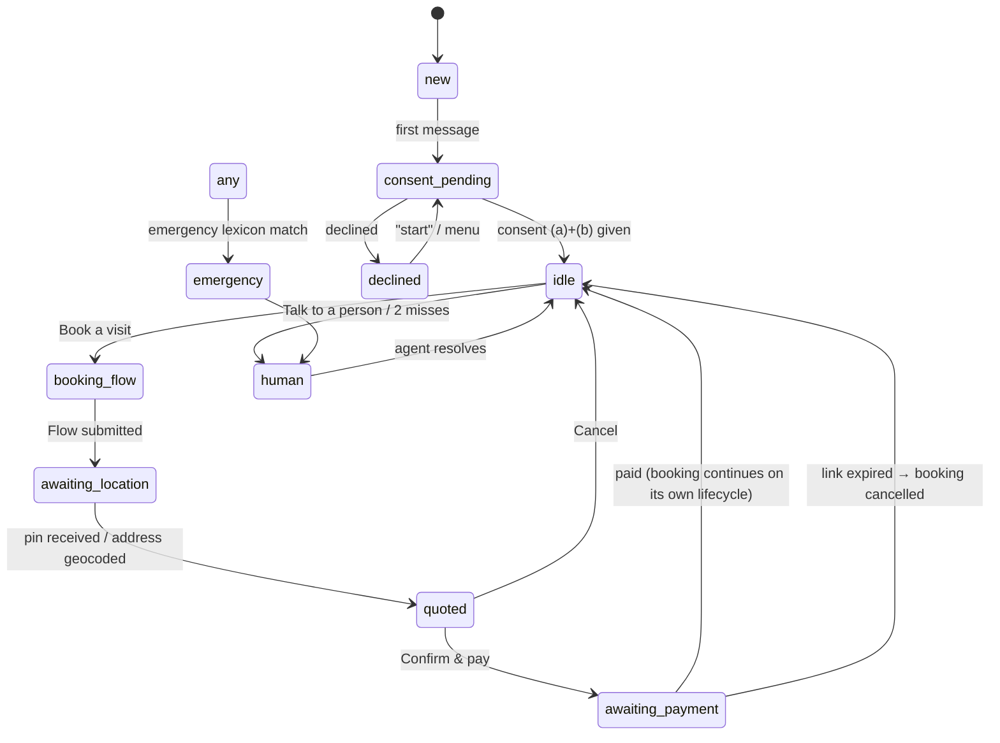

# PRD — WhatsApp Patient Channel

| | |
|---|---|
| **Product** | Oakly (Oaklycare) home-healthcare marketplace |
| **Document owner** | Product / Engineering |
| **Status** | Draft v1, for review |
| **Date** | 2026-09-30 |
| **Related** | [Proposal](../proposals/2026-09-29-whatsapp-patient-channel.md) · [Admin Console PRD](PRD-admin-console.md) · [Master checklist](../checklist/MASTER_CHECKLIST.md) |
| **Launch markets** | Lagos (MVP), then Abuja |

> **Conventions.**
> - Requirement IDs are stable: **WA-FR-n** (functional), **WA-NFR-n** (non-functional), **WA-US-n** (user stories). Reference them in tickets and PRs.
> - **Must / Should / Could** follow MoSCoW.
> - Items marked **[DECISION]** wait on a founder decision listed in §16. The value next to them is a proposed default.
> - Items marked ⚠️ depend on an external fact we have not yet confirmed.

---

## 1. Summary

Patients, and family members booking for them, will find, book and pay for Oakly home-care visits entirely inside **WhatsApp**. Updates, reminders and a FallGuard check also arrive there. Anything WhatsApp can't do safely or at all opens in a small, secure **web companion** reached from a link in the chat. That covers live caregiver tracking, vitals, results, visit notes and video consultations. The existing **FastAPI backend** remains the system of record. WhatsApp is a new channel that calls the same booking, pricing, payment and matching services.

## 2. Problem

- **Installing an app is the biggest drop-off for a first booking.** The patient app is only partly built (most screens beyond booking and FallGuard are mocks), and it is four Expo SDK versions behind.
- **Our buyers already live on WhatsApp.** Two groups matter most: patients who book for themselves, and adult children booking care for a parent, often from another city or abroad. About 98% of Nigerian internet users use WhatsApp ⚠️ (secondary source).
- **Family bookers are poorly served today.** The app ties everything to one patient login, and the family-member table has no API.
- **Patients get no messages when things happen.** Nothing tells them a caregiver accepted, started or completed a visit, or that a refund was processed (`services/booking.py`, `patient_wallet.py`).

## 3. Goals and non-goals

### Goals

| # | Goal | Measure (pilot target, to be confirmed) |
|---|---|---|
| G1 | A first-time user goes from "Hi" to a paid booking without installing anything | Median time to book < 5 min |
| G2 | The channel converts | First message → paid booking ≥ 25% |
| G3 | Payments complete | Payment-link completion ≥ 70% |
| G4 | Every booking state change reaches the booker | 100% of state changes send a notification |
| G5 | Health data stays compliant | 0 clinical values found in WhatsApp payloads (audited) |
| G6 | The channel is cheap enough | Channel cost < 3% of booking value |

### Non-goals (this PRD)

- Selling, pricing or delivering **medication** through WhatsApp. Meta's Commerce Policy prohibits it.
- Clinical conversations, diagnoses or treatment advice **in chat**. Doctor consultations happen by video in the web companion (Phase 3).
- **Live location** inside WhatsApp. The Cloud API does not support it.
- Replacing the **caregiver app**. Field staff keep the native app; WhatsApp is at most an extra alert channel for them.
- A general-purpose **AI assistant**. Meta's AI-provider restriction applies from 2026-01-15.

## 4. Users

| Persona | Description | Main needs |
|---|---|---|
| **Self-booker** | An adult booking care for themselves (post-op nursing, chronic-condition checks) | Fast booking, a clear price, reliable arrival |
| **Family booker** | An adult child, possibly remote or abroad, booking and paying for a parent | Booking for someone else, updates without the parent's involvement, trust signals |
| **Care recipient** | The person receiving care, often elderly, may not use WhatsApp | Safety; consent over their own health data |
| **Oakly support agent** | Handles handovers from the bot | A shared inbox with context and quick actions (see the Admin Console PRD) |

## 5. Scope and phasing

| Capability | Phase 1: Lagos MVP | Phase 2: Care & Abuja | Phase 3: Doctors |
|---|---|---|---|
| Opt-in and consent | ✅ | | |
| Sign-up / account linking by phone | ✅ | | |
| Book a home visit (nurse, caregiver, physiotherapist) | ✅ | | |
| Doctor home visit (existing product) | ✅ | | |
| Price quote, Paystack payment link, confirmation | ✅ | | |
| Booking notifications and reminders | ✅ | | |
| My bookings: view and cancel | ✅ | reschedule | |
| Booking for someone else (care recipients) | ✅ basic | care circle; recipient self-consent | |
| Emergency screen and human handover | ✅ | | |
| Web companion: booking status and live tracking | ✅ | | |
| Visit completion rating | ✅ | | |
| FallGuard check (Flow) with the result in the web companion | | ✅ | |
| Vitals reminders, vitals in the web companion | | ✅ | |
| Pidgin | | ✅ | |
| Abuja (city pricing, supply) | | ✅ | |
| Doctor teleconsultation (video, e-prescription) | | | ✅ |
| Packages and recurring plans | | | ✅ **[DECISION]** |

---

## 6. Prerequisites: what must be true before Phase 1 can launch

The WhatsApp channel adds nothing if the core marketplace doesn't work. The code review of 2026-09-24/30 found that **it currently cannot complete a booking end to end**.

| # | Prerequisite | Why it blocks WhatsApp | Evidence |
|---|---|---|---|
| P1 | **Caregivers can be approved.** Admins need an approve/reject flow. | Matching requires `profile_status=='approved'`, and nothing ever sets it | `services/location.py:48`; see the Admin Console PRD |
| P2 | **Matching compares service type with structured skills** | `specialization ILIKE '%nurse%'` never matches options like "Elderly Care" | `services/location.py` |
| P3 | **The caregiver app reports location and availability** | `caregiver_locations` stays empty because the app never calls `/booking/caregiver/location` | `caregiver/src/services/booking.service.ts` |
| P4 | **Re-dispatch and timeout when nobody accepts** | A paid booking stays `pending` forever | `services/booking.py:222-297` |
| P5 | **The Paystack webhook is safe to replay and checks the amount paid** | Payment links make webhooks the main confirmation path | `endpoints/payment.py:22-119` |
| P6 | **Unpaid bookings expire (scheduler)** | Payment links must expire | `auto_cancel_unpaid_bookings` is never called |
| P7 | **Booking creation doesn't require an email** | WhatsApp users may have none; Paystack needs one | `services/booking.py:180-190` |
| P8 | **Caregiver actions check ownership** | Any caregiver can cancel or accept any booking today | `services/booking.py:337-394` |
| P9 | **Critical security items are closed** (secrets rotated, WebSockets authenticated, uploads private, prescription endpoints protected) | Launching a new public channel on top of known vulnerabilities is not acceptable | `MASTER_CHECKLIST.md` §1–2 |
| P10 | **Money is stored in integer kobo** | Units are mixed today (Float naira on bookings, int kobo on caregiver wallets) | `db/models/booking.py`, `caregiver.py` |
| P11 | **Meta Business verification and a WhatsApp Business Account** | Required to send any message | §13 |

---

## 7. User stories

### Onboarding and consent

- **WA-US-1**: As a first-time user, I can message the Oakly number and be told what Oakly does and what it needs from me, so that I trust it.
- **WA-US-2**: As a first-time user, I can give consent for terms, health-data processing and WhatsApp processing in one step, so that I can start booking.
- **WA-US-3**: As a user, I can withdraw consent or opt out at any time by sending STOP or STOP DATA.

### Booking

- **WA-US-4**: As a self-booker, I can book a nurse, caregiver or physiotherapist for a date, time and duration at my address.
- **WA-US-5**: As a family booker, I can book for "someone else", save them as a recipient (e.g. "Mum"), and reuse them next time.
- **WA-US-6**: As a booker, I see an itemised price before I commit.
- **WA-US-7**: As a booker, I can pay by card, bank transfer or USSD through a secure link, and get a confirmation in chat.
- **WA-US-8**: As a booker, I'm told when a caregiver is assigned, with their first name, photo and rating.
- **WA-US-9**: As a booker, I get reminders before the visit, and a tracking link when the caregiver is on the way.
- **WA-US-10**: As a booker, I can see my upcoming and past bookings and cancel an upcoming one, with the refund rules shown before I confirm.
- **WA-US-11**: As a booker, I can rate the visit after it's done.

### Safety and support

- **WA-US-12**: As a user describing an emergency, I'm told immediately to call emergency services, and a human is alerted.
- **WA-US-13**: As a user, I can reach a human from any point in the conversation.

### Phase 2

- **WA-US-14**: As a patient, I can take the FallGuard check in chat and see my result securely.
- **WA-US-15**: As a patient, I get vitals reminders and log my vitals in the web companion.
- **WA-US-16**: As a care recipient, I can give or refuse consent for my family member to see my health information.
- **WA-US-17**: As a family member, I can add siblings to a "care circle" who also get updates.

### Phase 3

- **WA-US-18**: As a patient, I can pay for and join a video consultation with a licensed doctor.
- **WA-US-19**: As a patient, I receive my consultation summary and e-prescription in the web companion.

---

## 8. Functional requirements

### 8.1 Entry, identity and account linking

| ID | Requirement | Priority |
|---|---|---|
| WA-FR-1 | The bot answers the first inbound message from any WhatsApp number within 5 s with a greeting, a one-line description of Oakly, and the consent step (WA-FR-5). | Must |
| WA-FR-2 | A **contact** is identified by its WhatsApp ID (`wa_id`). On the first message, the backend creates a `whatsapp_contacts` row and an Oakly `User` with `user_type='patient'` and `phone_number` taken from WhatsApp. Email and password are optional (§11). | Must |
| WA-FR-3 | If an existing `User` has the same phone number (for example, from the patient app), link to it instead of creating a duplicate. The link is confirmed with a one-time code sent through the **authentication** template, or through the app when the user already uses it. | Must |
| WA-FR-4 | Supported entry points: a direct message; a Click-to-WhatsApp ad (whose 72-hour free window is recorded); a QR code or `wa.me` link carrying a campaign code in the prefilled text (`ref:XXXX`); and the website button. The source is saved on the contact. | Should |

### 8.2 Consent and opt-out

| ID | Requirement | Priority |
|---|---|---|
| WA-FR-5 | Before collecting any health information, show a **consent Flow**. It contains a plain-language notice (what we collect, why, that WhatsApp/Meta processes messages outside Nigeria, and a link to the privacy policy) and three checkboxes: (a) Terms & Privacy, **required**; (b) processing of health information to deliver care, **required**; (c) marketing messages, **optional**. | Must |
| WA-FR-6 | Every consent decision is stored in `consents` with: contact, subject (self or a recipient), consent type, the **policy version**, timestamp, channel (`whatsapp_flow`), and the message ID as evidence. | Must |
| WA-FR-7 | If the user declines (a) or (b), the bot explains what Oakly can't do without it and offers a human or a phone line. It sends no further automated messages except the reply to that message. | Must |
| WA-FR-8 | **STOP** means opt out of all non-essential messages. **STOP DATA** starts consent withdrawal: the bot confirms and creates a support/compliance task. Transactional messages for an already-paid booking may continue until it's done, and the confirmation says so. **START** re-subscribes. | Must |
| WA-FR-9 | No marketing-category template goes to a contact without consent (c). | Must |

### 8.3 Main menu and navigation

| ID | Requirement | Priority |
|---|---|---|
| WA-FR-10 | After consent, and whenever the user sends "menu" or "hi", show an interactive **list message** with: *Book a visit · My bookings · Talk to a doctor* (Phase 3; until then "Doctor home visit") *· FallGuard check* (Phase 2) *· My health dashboard* (link) *· Talk to a person · Help*. | Must |
| WA-FR-11 | Free text outside a Flow is matched with keywords (booking, cancel, price, help, agent, and Pidgin equivalents in Phase 2). Anything unrecognised gets a short clarification and the menu. After **2 consecutive** misses, offer a human (WA-FR-40). | Must |
| WA-FR-12 | Every step supports "back" and "cancel". Idle conversation state expires after 30 min, and the next message starts fresh from the menu, without losing a booking that has already been created. | Must |

### 8.4 Booking a home visit

| ID | Requirement | Priority |
|---|---|---|
| WA-FR-13 | "Book a visit" opens a **booking Flow**. Screen 1: *Who is this for?* (Myself / a saved recipient / Someone new). Screen 2 (if new): recipient's full name, relationship, date of birth or approximate age, gender, emergency contact phone (optional). Screen 3: service type (**nurse, caregiver, physiotherapist, doctor home visit**, plus nutritionist if kept **[DECISION]**), shown with the price per hour from pricing settings. Screen 4: date (CalendarPicker, today + up to 30 days) and start time (slots from the Flow data endpoint; only slots with estimated supply). Screen 5: duration (1–24 h, capped per service **[DECISION]**), condition or needs (free text, ≤ 500 characters), special instructions (optional). Screen 6: address (street, area, city: Lagos/Abuja only). | Must |
| WA-FR-14 | After the Flow is submitted, the bot sends a **location request** message so the user can drop a pin. If they skip it, geocode the typed address; if that fails, a human follows up before dispatch. Coordinates are stored on the booking (`patient_latitude/longitude`). | Must |
| WA-FR-15 | Service areas: addresses outside the active cities or radius are rejected with a clear message and a waitlist opt-in. **[DECISION]** Lagos radius or LGA list. | Must |
| WA-FR-16 | The Flow data endpoint returns within **≤ 3 s at p95**; Meta's hard limit is 10 s. On timeout, the Flow shows a retry message. | Must |
| WA-FR-17 | Recipients are saved in `care_recipients` and linked through `care_relationships` (§10). A contact can manage up to **10** recipients. | Must |

### 8.5 Price quote

| ID | Requirement | Priority |
|---|---|---|
| WA-FR-18 | The quote uses the **same pricing service** as `POST /booking/preview` (§2.2 of the proposal): `duration × base_fee × multiplier[service] (× surge) (× (1−discount))`, plus the platform fee. It must never be computed separately for the chat. | Must |
| WA-FR-19 | The quote message shows: service, recipient first name, date and time, duration, service fee, platform fee, any surge or discount line, **total**, and the cancellation policy line. Buttons: **Confirm & pay** · **Change** · **Cancel**. | Must |
| WA-FR-20 | The quoted price is **locked for 30 min** (stored on a pending booking, or on a quote record). If pricing settings change in that time, the locked price still applies. | Must |
| WA-FR-21 | Every service type offered must have an **explicit multiplier**. The pricing service refuses to quote a service with no configured multiplier; it no longer falls back to 1.0. **[DECISION]** rates for caregiver and physiotherapist. | Must |

### 8.6 Payment

| ID | Requirement | Priority |
|---|---|---|
| WA-FR-22 | **Confirm & pay** creates the booking (`status=pending`, `payment_status=pending`, `channel='whatsapp'`, `booked_by_contact_id`, `care_recipient_id`) and initialises a Paystack transaction. The bot sends a **Pay now** CTA-URL button with the Paystack checkout URL. No card details are ever requested in chat. | Must |
| WA-FR-23 | Paystack email: use the contact's email if given, otherwise a deterministic internal address (`wa-<hash(wa_id)>@pay.oaklycare.com`, not deliverable). ⚠️ Confirm Paystack's terms allow this. | Must |
| WA-FR-24 | The payment link **expires 30 min** after it's sent. At **20 min**, send `payment_link_expiring`. At **30 min**, cancel the booking (`cancelled`, reason `unpaid_timeout`) and send `booking_cancelled_unpaid` with a **Book again** button. | Must |
| WA-FR-25 | On a Paystack `charge.success` webhook: (1) verify the signature; (2) **ignore it if already processed** (same reference); (3) **check `amount` equals the booking total in kobo**; if not, flag it for admin review and don't confirm; (4) set `payment_status=paid`; (5) send `payment_received`; (6) start matching. | Must |
| WA-FR-26 | The Paystack `callback_url` points to a web companion page showing "Payment received, return to WhatsApp", with a `wa.me` deep link back to the chat. | Should |
| WA-FR-27 | If the user returns to the chat before the webhook arrives, the bot verifies the transaction with Paystack (`verify`) before replying. | Should |

### 8.7 Matching and assignment (behaviour visible to the patient)

| ID | Requirement | Priority |
|---|---|---|
| WA-FR-28 | Matching only considers caregivers who are approved, available, have reported their location within the **last 15 min**, have a skill matching the service type, and are within the service radius. | Must |
| WA-FR-29 | Wave dispatch: notify the top N (default **8**) caregivers through the caregiver app push. If nobody accepts in **10 min**, widen to the next wave. After **30 min** in total (or **2 h** for bookings scheduled more than 24 h ahead **[DECISION]**), escalate to the admin "unmatched" queue and send the booker `matching_delayed`. | Must |
| WA-FR-30 | On acceptance, send `caregiver_assigned` with the caregiver's **first name**, profile photo (header image), years of experience, rating (once available), and a **View booking** link to the web companion. | Must |
| WA-FR-31 | If the booking remains unmatched at **T−2 h** before the scheduled start, or an admin marks it unfulfillable, send `no_caregiver_found`. Buttons: **Full refund** · **Pick another time**. A refund starts the refund flow (Admin PRD). | Must |

### 8.8 Visit lifecycle notifications

| ID | Trigger | Template | Priority |
|---|---|---|---|
| WA-FR-32 | T−24 h (only for bookings made more than 24 h ahead) | `visit_reminder_24h` | Must |
| WA-FR-33 | T−1 h | `visit_reminder_1h` | Must |
| WA-FR-34 | Caregiver taps **On my way** in the caregiver app | `caregiver_en_route`, with the tracking link (WA-FR-45) | Must |
| WA-FR-35 | Caregiver checks in: they enter a **4-digit visit code** that the bot sent the booker; the booker reads it out. The booking moves to `in_progress`. | `visit_started` | Must |
| WA-FR-36 | Caregiver checks out; the booking moves to `completed` | `visit_completed_feedback`, with 1–5 quick-reply rating buttons, an optional comment, a link to visit notes, and **Book again** | Must |
| WA-FR-37 | Booking cancelled by the caregiver or an admin | `booking_update` with the next step (automatic re-dispatch or refund) | Must |

### 8.9 My bookings and cancellation

| ID | Requirement | Priority |
|---|---|---|
| WA-FR-38 | "My bookings" lists the **5 most recent** bookings for this contact and all their recipients: code, date, service, status. Selecting one shows its details, with actions allowed by its status. | Must |
| WA-FR-39 | Cancellation by the booker: before assignment, full refund. After assignment and more than 12 h before start, full refund. Within 12 h, a fee **[DECISION: e.g. 20%]**. Once in progress, cancellation isn't allowed in chat; the user is handed to a human. The policy is shown before the user confirms. Cancelling creates a refund per the Admin PRD refund module. | Must |
| WA-FR-39a | Reschedule (Phase 2): allowed while more than 12 h before start; re-runs slot selection. If the price changes, the bot shows the difference. | Should |

### 8.10 Safety, emergency and human handover

| ID | Requirement | Priority |
|---|---|---|
| WA-FR-40 | **Emergency screen.** Every inbound text, and every Flow free-text field, is checked against an emergency lexicon (English + Pidgin; e.g. "chest pain", "can't breathe", "not breathing", "unconscious", "seizure", "heavy bleeding", "stroke", "suicide", "kill myself", "overdose"). On a match, the bot **immediately** replies with the emergency message (call **112**, plus the state-specific numbers ⚠️ to be verified per state before launch). It then opens an **urgent** handover ticket and pauses automation for that contact until an agent resolves it. | Must |
| WA-FR-41 | **Human handover.** "Talk to a person", 2 consecutive misunderstandings, a failed payment dispute, or an emergency creates a `support_conversations` ticket, visible in the Admin Console inbox. While a human owns the conversation, the bot stays silent except for the emergency screen. Out of support hours **[DECISION]**, the bot states when someone will reply. | Must |
| WA-FR-42 | The bot never gives medical advice, diagnoses or medication instructions. Any request that looks clinical ("what should I take for…") gets a fixed reply: book a doctor or nurse, or call emergency services. | Must |

### 8.11 Web companion (reached by link)

| ID | Requirement | Priority |
|---|---|---|
| WA-FR-43 | **Magic links**: signed, single-use, **15-minute** tokens tied to a contact and a purpose (`booking:{id}`, `tracking:{id}`, `dashboard`). Opening one creates a web session (httpOnly cookie, 12 h). Tokens are never logged. | Must |
| WA-FR-44 | **Step-up authentication** is required before showing clinical data (vitals, FallGuard results, visit notes, prescriptions): a 6-digit code sent through the `login_code` authentication template, valid 5 min, maximum 5 attempts. | Must |
| WA-FR-45 | **Tracking page**: the caregiver's position (from the caregiver app, refreshed every ≤ 10 s), ETA, their first name and photo, and the booking status. Available from **en route** until **check-in**, then it expires. It shows **no** health information. | Must |
| WA-FR-46 | **Booking page**: status timeline, price breakdown and receipt, caregiver card, cancel (applying WA-FR-39), and support. | Must |
| WA-FR-47 | **Dashboard** (Phase 2): recipients, upcoming visits, vitals (entry and charts), FallGuard history, visit notes. Consent gating per WA-FR-54. | Should |
| WA-FR-48 | Mobile-first PWA; works on low-end Android over 3G, first load < 3 s on a 3G profile. | Must |

### 8.12 FallGuard via WhatsApp (Phase 2)

| ID | Requirement | Priority |
|---|---|---|
| WA-FR-49 | "FallGuard check" asks who it's for (self or a recipient), then opens a Flow built from the **active** `fallguard_questions` in `order`. | Should |
| WA-FR-50 | The **server calculates** each answer's score from the question's `options` and the total. The client never sends scores (unlike today's app, `services/fallguard.py:52`). Risk bands move from the patient app to the server: ≤3 Low · ≤7 Moderate · ≤12 High · >12 Very High. | Must (for this feature) |
| WA-FR-51 | The chat replies only with `result_ready` and a link. The score, band and AI summary appear **only** in the web companion after step-up authentication. A High or Very High result offers **Book a physiotherapist or nurse**. | Should |

### 8.13 Vitals (Phase 2)

| ID | Requirement | Priority |
|---|---|---|
| WA-FR-52 | Users can set vitals reminders (daily or weekly, with a time) that send `vitals_reminder` with a link. **No vitals value is ever sent or accepted over WhatsApp.** If a user types a reading in chat, the bot replies with the secure link and does not store the text. | Should |

### 8.14 Care recipients and consent for someone else

| ID | Requirement | Priority |
|---|---|---|
| WA-FR-53 | A booker can book and pay for a recipient without the recipient's consent. They see logistics only: status, caregiver, times. | Must |
| WA-FR-54 | Clinical information about a recipient (visit notes, vitals, FallGuard, prescriptions) is visible to the booker **only after** the recipient's consent is recorded. There are two ways: (a) the recipient's own WhatsApp number receives a consent request (Phase 2); (b) the caregiver captures the recipient's signed consent in the caregiver app at the first visit. A documented guardian or legal authority can be recorded by an admin. | Must |
| WA-FR-55 | Care circle (Phase 2): the recipient, or a consented primary booker, can invite up to 5 contacts to receive logistics updates. Each invitee opts in themselves. | Could |

### 8.15 Doctor teleconsultation (Phase 3)

| ID | Requirement | Priority |
|---|---|---|
| WA-FR-56 | "Talk to a doctor" runs a triage Flow (symptoms, duration, emergency screen, urgency) and quotes a **session price** (`service_mode='teleconsult'`, 15 or 30 min **[DECISION]**). | Should |
| WA-FR-57 | After payment, the consult is queued for doctors in the clinician console. When a doctor accepts, the patient gets `consult_starting` with a video link that opens in the web companion. The video provider is not WhatsApp. | Should |
| WA-FR-58 | After the call, the summary and e-prescription appear in the web companion. The bot sends only `result_ready`. The patient chooses a partner pharmacy outside WhatsApp. | Should |

---

## 9. Conversation design

### 9.1 State machine (per contact)



- The conversation state (`whatsapp_conversations.state` + `context` JSON) is separate from the **booking** lifecycle. Once a booking is created it follows the backend booking state machine, and notifications are sent from domain events.
- Context kept per state includes the draft booking, the selected recipient, the quote ID, and retry counters.

### 9.2 Sample transcript (happy path, abbreviated)

```
User:  Hi
Oakly: Welcome to Oakly 👋 We send trusted nurses and caregivers to your home in Lagos.
       Before we start, please review and accept how we handle your information.   [Review & accept] (Flow)
User:  (accepts a + b)
Oakly: Thanks, Tolu. What would you like to do?                                   [Menu ▾]
User:  Book a visit
Oakly: (booking Flow → Someone else: "Mum", 67 · Nurse · Sat 4 Oct, 10:00 · 4 hours · "post-surgery wound dressing" · Lekki Phase 1)
Oakly: Please share the location for this visit so the nurse can find it.         [Send location]
User:  (location pin)
Oakly: Here's your quote for Mum:
       Nurse · Sat 4 Oct, 10:00–14:00
       Service fee   ₦40,000
       Platform fee   ₦4,000
       Total         ₦44,000
       Free cancellation until 12 hours before the visit.          [Confirm & pay] [Change] [Cancel]
User:  Confirm & pay
Oakly: Tap below to pay securely with card, transfer or USSD. This link expires in 30 minutes.   [Pay now ↗]
       … (Paystack webhook) …
Oakly: Payment received ✅ Booking OK-7F3K2Q is confirmed. We're finding a nurse for Mum now.
       … (caregiver accepts) …
Oakly: Nurse Ada (6 yrs experience) will visit Mum on Sat 4 Oct at 10:00.        [View booking ↗]
```

### 9.3 Content rules

- **Tone:** warm, short, plain English. One question per message. Money formatted `₦44,000`. Dates like `Sat 4 Oct, 10:00` in **WAT**.
- **Never in any message:** diagnoses, medication names, vitals values, FallGuard scores, full addresses of other people, or a caregiver's surname or phone number.
- The **condition** text a user types in the booking Flow goes only to the backend. It is never echoed back in chat or in templates.
- Every template follows Meta's utility rules: no promotional wording.

---

## 10. Data model changes

| Table | Key columns | Notes |
|---|---|---|
| `whatsapp_contacts` | `id`, `wa_id` (unique), `phone_e164`, `user_id` FK, `display_name`, `language` (`en`/`pcm`), `source`, `opted_in_at`, `marketing_opt_in`, `opted_out_at`, `last_inbound_at`, `blocked` | One per WhatsApp identity. `last_inbound_at` drives the 24-hour window check. |
| `whatsapp_conversations` | `id`, `contact_id`, `state`, `context` JSONB, `assigned_agent_id` (nullable), `automation_paused`, `updated_at` | One active per contact |
| `whatsapp_messages` | `id`, `contact_id`, `direction`, `meta_message_id` (unique), `type`, `template_name`, `category`, `status` (sent/delivered/read/failed), `error_code`, `cost_category`, `created_at` | **Metadata only. No message body is stored** (except agent-visible handover transcripts: §12, WA-NFR-9). |
| `care_recipients` | `id`, `full_name`, `date_of_birth`, `gender`, `phone_e164` (nullable), `address`, `city`, `state`, `lat`, `lng`, `notes_encrypted`, `created_by_user_id` | Replaces the idea behind the unused `patient_family_members`. A self-booker gets a recipient row pointing to themselves. |
| `care_relationships` | `id`, `contact_user_id`, `recipient_id`, `role` (`self`/`family`/`guardian`), `clinical_access` (bool), `created_at` | Controls WA-FR-53/54 |
| `consents` | `id`, `subject_recipient_id` or `subject_user_id`, `granted_by_user_id`, `type` (`terms`, `health_processing`, `marketing`, `share_with_family`), `policy_version`, `granted_at`, `withdrawn_at`, `channel`, `evidence_ref` | Append-only |
| `quotes` | `id`, `contact_id`, `payload` JSONB (inputs + breakdown in kobo), `settings_id`, `expires_at` | Locks the price (WA-FR-20) |
| `bookings` (alter) | + `channel` (`app`/`whatsapp`/`admin`), `booked_by_user_id`, `care_recipient_id`, `visit_code_hash`, `cancel_reason`, `payment_expires_at`; money columns → **integer kobo** | Migration moves existing Float naira to kobo |
| `booking_dispatch_waves` | `id`, `booking_id`, `wave_no`, `notified_caregiver_ids`, `sent_at`, `expires_at` | For WA-FR-29 |
| `booking_ratings` | `id`, `booking_id` (unique), `rated_by_user_id`, `stars` 1–5, `comment`, `created_at` | No rating model exists today |
| `message_templates` | `name`, `language`, `category`, `meta_status`, `body_preview`, `variables` | A local mirror of Meta approval status |

All new tables come with **Alembic migrations**. The current migration graph has two roots, which must be fixed first (see the master checklist).

---

## 11. API and integration surface

### 11.1 Inbound (from Meta)

| Endpoint | Purpose |
|---|---|
| `GET /api/v1/whatsapp/webhook` | Verification handshake (`hub.mode`, `hub.verify_token`, `hub.challenge`) |
| `POST /api/v1/whatsapp/webhook` | Messages and status updates. Verify `X-Hub-Signature-256` with the app secret; **reply 200 within 1 s** and put the work on a queue; deduplicate on `meta_message_id`. |
| `POST /api/v1/whatsapp/flows/data` | Flow data exchange: decrypt (RSA-OAEP + AES-GCM), handle `INIT`/`data_exchange`/`BACK`, encrypt the response. p95 ≤ 3 s. |

### 11.2 Outbound (to Meta)

- Graph API `POST /{phone-number-id}/messages`, through **PyWa** (async). Covers text, interactive list and buttons, CTA URL, location request, Flow, and template messages.
- A rate-limited sender with exponential-backoff retries on 429 and 5xx errors. Terminal failures (131026 undeliverable, 131047 re-engagement required, etc.) are recorded on `whatsapp_messages`.

### 11.3 Internal service calls

The channel only uses domain services; it never touches tables directly:
- `PricingService.quote()`
- `BookingService.create()`, `.cancel()`
- `PaymentService.init_link()`
- `DispatchService.start()`
- `NotificationService.notify(event, recipients)`
- `ConsentService`
- `RecipientService`

`NotificationService` is channel-agnostic: WhatsApp template, caregiver-app push, or email.

### 11.4 Web companion API

- `POST /api/v1/companion/session` (exchange a magic token for a session)
- `POST /api/v1/companion/step-up` and `/verify`
- `GET /api/v1/companion/bookings/{id}`
- `GET /api/v1/companion/tracking/{id}` (plus WebSocket or SSE)
- Phase 2: `/recipients`, `/vitals`, `/fallguard`

All scoped by `care_relationships` and consent.

### 11.5 Paystack

- The existing `initialize_transaction`, called with `callback_url` set to the web companion.
- Webhook hardening per WA-FR-25.
- Refunds through the Paystack refund API, triggered by the Admin Console refund module. The wallet is **not** credited as well.

---

## 12. Non-functional requirements

| ID | Requirement |
|---|---|
| WA-NFR-1 **Latency** | Bot reply p95 ≤ 3 s from the inbound webhook to the outbound API call. Flow data endpoint p95 ≤ 3 s. |
| WA-NFR-2 **Reliability** | Webhook processing is idempotent. The queue retries with backoff and a dead-letter queue. No inbound message is lost if a worker restarts. |
| WA-NFR-3 **Availability** | 99.5% monthly for the webhook and the web companion during the pilot. **Move off Render's free plan**, since it sleeps and would miss webhooks. |
| WA-NFR-4 **Scale (pilot)** | 2,000 contacts and 500 bookings/month, with headroom for 10×. Meta tier 250 at start, 2K after verification. |
| WA-NFR-5 **Security** | Verify signatures on every webhook (Meta and Paystack). Secrets (Meta token, app secret, Flow private key, Paystack keys) live in the platform secret store, never in git. The Flow private key is rotated yearly. |
| WA-NFR-6 **Data minimisation** | Store no message bodies by default. Health data never goes into templates or bot messages. The condition field is stored encrypted. |
| WA-NFR-7 **Encryption** | New health fields (`care_recipients.notes`, booking `condition`) use the same field-level encryption as vitals, with the key in the secret store and a rotation plan. |
| WA-NFR-8 **Access control** | Web companion routes are scoped to the session's contact and relationships. Clinical views require step-up authentication. Every clinical read is written to the audit log (Admin PRD). |
| WA-NFR-9 **Retention** | Message metadata: 12 months. Handover transcripts: 90 days. Consents: life of the account + 6 years **[DECISION with counsel]**. Clinical records follow medical-records rules ⚠️ counsel. |
| WA-NFR-10 **Compliance** | NDPA 2023 + GAID 2025: DPIA completed before the pilot; privacy notice published; DPO named; NDPC registration if Oakly qualifies as a data controller of major importance ⚠️ counsel. |
| WA-NFR-11 **Meta policy** | Opt-in before any outbound message. Templates stay within their category. Quality rating monitored; alert on a drop to *Medium*. |
| WA-NFR-12 **Observability** | Structured logs keyed by contact ID hash (never phone or name), plus metrics and alerts: webhook error rate, queue lag, template failure rate, payment-link conversion, matching time. |
| WA-NFR-13 **Localisation** | English at launch; Nigerian Pidgin in Phase 2. All copy lives in a string table, not in code. |
| WA-NFR-14 **Accessibility** | Short messages, buttons wherever possible, no information conveyed only by emoji. The web companion meets WCAG 2.1 AA. |
| WA-NFR-15 **Testing** | Contract tests with recorded Meta and Paystack payloads (captured live, per the FE-guide rule). The conversation state machine has full transition coverage. There is an end-to-end sandbox run with a Meta test number before each release. |

---

## 13. Dependencies and operations

- **Meta:**
  - A Business portfolio, **business verification** (CAC certificate, address, domain), a dedicated phone number, and approval of the display name.
  - A WhatsApp Business Account on the Cloud API, with a system-user token.
  - A **payment method on file** (required from 2026-10-01 for service messages).
  - Template approvals (§14).
- **Paystack:** live keys, webhook URL, callback URL, and a check of the email requirement ⚠️.
- **Infrastructure:**
  - Redis for the queue and cache.
  - Workers (ARQ or Celery) and a scheduler (reminders, expiry, dispatch waves).
  - Web companion hosting.
  - A non-sleeping backend plan.
- **Caregiver app:**
  - Location reporting, availability toggle, push notifications (Expo), job accept/decline, *On my way*, check-in with the visit code, check-out.
  - These are **P3/P4 dependencies**.
- **Admin Console:** caregiver approval, unmatched queue, refunds, support inbox, template and consent views. See the Admin Console PRD.
- **Legal:** DPIA, privacy notice text, consent wording, retention periods, emergency wording, and the telemedicine review (Phase 3).
- **Support staffing:** hours and escalation rota **[DECISION]**.

## 14. Message templates

All templates are submitted in English first and in Pidgin in Phase 2. Variables are shown as `{{n}}`. The wording below is draft copy for Meta review.

| Name | Category | Draft body | Buttons |
|---|---|---|---|
| `booking_payment_link` | Utility | Your Oakly booking {{1}} for {{2}} on {{3}} is ready. Total: {{4}}. Complete payment within 30 minutes to confirm. | URL: Pay now |
| `payment_link_expiring` | Utility | Your payment link for booking {{1}} expires in 10 minutes. | URL: Pay now |
| `payment_received` | Utility | Payment of {{1}} received for booking {{2}}. We're assigning a professional now. | — |
| `booking_cancelled_unpaid` | Utility | Booking {{1}} was cancelled because payment wasn't completed. | Quick reply: Book again |
| `matching_delayed` | Utility | We're still finding the right professional for booking {{1}}. We'll update you within {{2}}. | — |
| `caregiver_assigned` | Utility | {{1}} will visit on {{2}} at {{3}} for booking {{4}}. | URL: View booking |
| `no_caregiver_found` | Utility | We couldn't confirm a professional for booking {{1}}. Choose a full refund or a new time. | Quick replies: Full refund · New time |
| `visit_reminder_24h` / `visit_reminder_1h` | Utility | Reminder: {{1}} visits on {{2}} at {{3}} (booking {{4}}). | URL: View booking |
| `caregiver_en_route` | Utility | {{1}} is on the way. Estimated arrival: {{2}}. | URL: Track |
| `visit_code` | Utility | Your visit code for booking {{1}} is {{2}}. Share it with the professional when they arrive. | — |
| `visit_completed_feedback` | Utility | Visit {{1}} is complete. How was it? | Quick replies: 5 ★ … 1 ★ |
| `booking_update` | Utility | Update on booking {{1}}: {{2}} | URL: View booking |
| `refund_update` | Utility | Your refund of {{1}} for booking {{2}} has been {{3}}. | — |
| `result_ready` | Utility | Your {{1}} is ready to view securely. | URL: View |
| `vitals_reminder` | Utility | It's time to log your readings. | URL: Log now |
| `consult_starting` | Utility | Your consultation starts at {{1}}. | URL: Join |
| `login_code` | Authentication | {{1}} is your Oakly verification code. | Copy code |
| `reengagement_offer` | Marketing | *(marketing consent only)* | — |

## 15. Analytics and success metrics

- **Funnel events:** `wa_first_message` → `consent_given` → `menu_shown` → `booking_flow_opened` → `booking_flow_submitted` → `location_received` → `quote_shown` → `quote_confirmed` → `payment_link_sent` → `payment_succeeded` → `caregiver_assigned` → `visit_started` → `visit_completed` → `rating_given`.
- **Properties on each event:** source/campaign, city, service type, self or other, recipient-new flag.
- **Cost:** a monthly reconciliation of Meta billing against `whatsapp_messages` categories gives cost per booking.
- **Dashboards:** these live in the Admin Console Overview (Admin PRD §7.1).
- **Targets:** see §3 (G1–G6).
- **Review cadence:** weekly during the pilot.

## 16. Open decisions

| # | Decision | Proposed default |
|---|---|---|
| D1 | Rates for **caregiver** and **physiotherapist** (currently falling back to the nurse rate) | Set explicitly before launch |
| D2 | **City pricing** and transport fee (Lagos vs Abuja) | Per-city `base_fee`; no transport fee in MVP |
| D3 | **Service radius** / list of LGAs for Lagos | Start with Lekki, VI, Ikoyi, Yaba, Surulere, Ikeja, Gbagada |
| D4 | **Cancellation fee** within 12 h | 20% of the service fee |
| D5 | **Matching timeouts** | 10-minute waves, 30-minute escalation |
| D6 | **Support hours** | 07:00–22:00 WAT, 7 days; emergency screen always on |
| D7 | Is **nutritionist** part of the WhatsApp MVP? | No, Phase 2 |
| D8 | Duration caps per service | Doctor ≤ 2 h; others 1–12 h; 24 h = live-in (Phase 3 packages) |
| D9 | Teleconsult length and price | 15 min, price to be set |
| D10 | Retention periods | Confirm with counsel |
| D11 | Display name and phone number | "Oakly Health" ⚠️ Meta review |

## 17. Release plan

| Stage | Gate |
|---|---|
| **Internal alpha** (Meta test number, staff only) | All Must requirements in §8.1–8.10 pass the E2E sandbox; prerequisites P1–P10 closed |
| **Closed pilot** (Lagos, ~50 invited users) | P11 done; DPIA signed; support rota live; 20 test bookings end to end |
| **Open Lagos** | Pilot metrics G2/G3 at ≥ 80% of target; no Sev-1 incidents for 2 weeks; quality rating High |
| **Abuja** | Supply ≥ 20 approved caregivers in Abuja; city pricing set |

## 18. Out of scope / future

- Native in-chat payments (revisit if Meta launches payments in Nigeria ⚠️).
- WhatsApp calling for consultations.
- An official business account (green tick).
- Group chats.
- Voice-note transcription.
- Care packages and subscriptions (Phase 3 decision).
